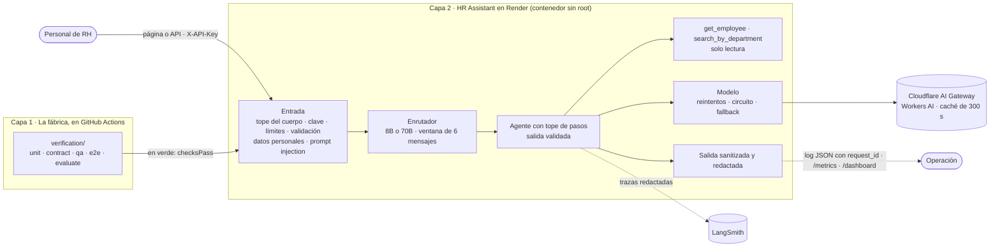

# HR Assistant

Asistente de Recursos Humanos que responde preguntas sobre empleados desde una página web. Está llevado a
producción con observabilidad, control de costos y seguridad. Es una API FastAPI **sin estado** con un agente de
bucle con tope y dos herramientas de solo lectura (`get_employee`, `search_by_department`) sobre
`data/employees.json`.

El sistema multi-agente tiene **dos capas** (ADR 0020):

- **Capa 1, la fábrica** (raíz del repositorio): especificaciones, agentes con roles y permisos separados, y las
  verificaciones que juzgan cada entrega. En cada push, el trabajo `factory` del CI corre esas verificaciones, y
  Render solo publica si pasan.
- **Capa 2, el HR Assistant** (esta carpeta): el agente que atiende `POST /ask` en Render, con modelos de Workers
  AI vía AI Gateway y trazas en LangSmith.



- **Rastreable**: `request_id` en todo, log JSON con auditoría, `/metrics` y `/dashboard`, y un árbol de trazas
  por pregunta en LangSmith.
- **Con costo medido**: cada respuesta dice qué modelo usó, por qué y cuánto costó. Cuatro palancas de costo
  están medidas contra una línea base: con el modelo simulado, 86.2 % menos costo con la misma calidad.
- **Seguro en capas**: 21 controles con su riesgo de OWASP LLM 2025, su prueba y su evidencia.
- **Listo para producción**: compliance como código, resiliencia del modelo, contenedor sin privilegios, CI con
  seis trabajos y Blueprint de Render que publica solo con el CI en verde.

| Tema | Documento |
| --- | --- |
| Arquitectura, flujo y despliegue | [`doc/architecture.md`](doc/architecture.md) y [`doc/adr/`](doc/adr/) (22 decisiones) |
| Costos | [`doc/cost-analysis.md`](doc/cost-analysis.md) |
| Seguridad | [`doc/security.md`](doc/security.md) y [`doc/compliance-checklist.md`](doc/compliance-checklist.md) |
| Observabilidad y runbook | [`doc/observability.md`](doc/observability.md) |
| Contrato de la API | [`doc/openapi.json`](doc/openapi.json) y `GET /docs` |
| Evidencias | [`doc/evidence/README.md`](doc/evidence/README.md) |

## Requisitos

- Python 3.12 y [uv](https://docs.astral.sh/uv/).
- Dependencias, en locks con versiones y hashes (ADR 0015):
  - `requirements.txt`: solo las de ejecución; es lo único que instala la imagen.
  - `requirements-dev.txt`: las de ejecución, con las mismas versiones, más pruebas, pylint, Playwright, PyYAML y
    pip-audit. Para desarrollar: `uv pip install --require-hashes -r requirements-dev.txt`.
  - Para cambiar una versión, edita `requirements.in` o `requirements-dev.in` y regenera el lock con el comando
    de su encabezado (`uv pip compile ... --generate-hashes`).
- Para el modelo real: una cuenta de Cloudflare con Workers AI y un AI Gateway (por omisión, `default`), y un
  token con **solo** estos permisos: **Workers AI: Read y Edit** y **AI Gateway: Run**. El gateway exige su propia
  autenticación: el producto manda el mismo token en `Authorization` y en `cf-aig-authorization` (ADR 0008).
- Para las trazas: una cuenta de LangSmith con una clave de tipo **Tracing Only** (solo crea trazas y proyectos).
- Para publicar: una cuenta de GitHub y otra de Render. Docker es opcional: el CI construye la imagen.

## Instalación

Desde una consola, clona el repositorio y crea el entorno en su raíz; `uv run` lo encuentra también desde
`product/`. Las dependencias de desarrollo incluyen las de ejecución, las pruebas y las verificaciones de la
fábrica.

```powershell
# PowerShell
git clone https://github.com/<usuario>/m4-hr-assistant.git
cd m4-hr-assistant
uv venv --python 3.12
uv pip install --require-hashes -r product/requirements-dev.txt
uv run playwright install chromium    # solo para las pruebas e2e
cd product
```

```bash
# Bash
git clone https://github.com/<usuario>/m4-hr-assistant.git
cd m4-hr-assistant
uv venv --python 3.12
uv pip install --require-hashes -r product/requirements-dev.txt
uv run playwright install chromium    # solo para las pruebas e2e
cd product
```

Sin uv, con Python 3.12: `python -m venv .venv`, activa el entorno (`.venv\Scripts\Activate.ps1` en PowerShell,
`source .venv/bin/activate` en Bash) y corre `python -m pip install --require-hashes --no-deps -r
product/requirements-dev.txt`, como el CI. Después usa `python` donde este documento dice `uv run python`.

## Cómo correrlo

`POST /ask` y `GET /metrics` piden una clave. En local, el cliente y su clave van en `API_KEYS` (la forma es
`cliente:clave`) dentro de `.env`, **nunca en el comando**: la línea quedaría en el historial de la consola, y
PowerShell lo guarda en texto plano. Desde esta carpeta (`product/`):

1. Copia la plantilla: `Copy-Item .env.example .env` (PowerShell) o `cp .env.example .env` (Bash). Git ignora
   `.env` y cualquier `.env.*`, salvo la plantilla.
2. En tu editor, escribe en `API_KEYS` un cliente llamado `local`, dos puntos y una clave larga que inventes. Nunca
   subas `.env` ni pegues sus valores en un chat.
3. Arranca con el modelo simulado (sin red ni costo); el comando es el mismo en PowerShell y en Bash:

```bash
uv run --env-file .env uvicorn app.main:app --no-access-log
```

`--no-access-log` apaga el log de acceso de uvicorn, que escribe líneas que no son JSON; el evento `request` ya
registra cada petición.

Abre http://127.0.0.1:8000, escribe en **Clave de acceso** la parte que va después de `local:` y pregunta, por
ejemplo, «¿Quién es EMP-0004?» o «¿Quiénes trabajan en Finanzas?». Cada respuesta muestra un **Id de soporte** (el
`request_id`). La página guarda la clave solo en `sessionStorage`: se borra al cerrar la pestaña.

### Con el modelo real

1. En el mismo `.env` (paso 1 de arriba), pon en tu editor `MODEL_PROVIDER=gateway`, tu `CF_ACCOUNT_ID` y tu
   `CF_API_TOKEN`. Nunca subas `.env` ni pegues sus valores en un chat.
2. Arranca con esas variables:

```bash
uv run --env-file .env uvicorn app.main:app --no-access-log
```

El plan gratuito de Workers AI tiene una cuota diaria: prueba primero con el modelo simulado. Si el gateway no
responde o se agota la cuota, `POST /ask` responde `502 {"detail": "model unavailable", "request_id": ...}`.

### Con Docker (opcional)

La misma imagen que publica Render, con tu `.env` (desde `product/`):

```bash
docker build -t m4-hr-assistant .
docker run --rm -p 8000:8000 --env-file .env m4-hr-assistant
```

## API

| Método y ruta | Clave | Qué hace |
| --- | --- | --- |
| `GET /` | No | La página web |
| `GET /health` | No | Prueba de vida: `{"status": "ok", "pid": ...}` (Render la usa) |
| `GET /ready` | No | Disponibilidad: `200` si el directorio está cargado y algún modelo tiene el circuito cerrado; `503` si no. Nunca llama al modelo |
| `GET /dashboard` | No (la página pide la clave) | Tablero de operación de este proceso: lee `/metrics` y lo muestra en tarjetas y tablas |
| `GET /docs` | No | Documentación interactiva (Swagger) con **Authorize** para `X-API-Key`, cada error con su ejemplo; el contrato exportado está en [`doc/openapi.json`](doc/openapi.json) |
| `POST /ask` | `X-API-Key` | Cuerpo `{"question": "...", "history": [...]}`; responde `answer`, `steps`, `tools_used`, `input_tokens`, `output_tokens`, `request_id`, `model`, `route`, `cached_calls` y `cost_usd` |
| `GET /metrics` | `X-API-Key` | Peticiones, `error_rate`, latencia p50/p95, tokens, SLO y `cost_usd` acumulado de este proceso |

Ejemplo, con el servidor local y la clave pedida sin mostrarla (nunca escrita en el comando):

```powershell
# PowerShell
$key = [Net.NetworkCredential]::new('', (Read-Host 'Clave' -AsSecureString)).Password
$body = [Text.Encoding]::UTF8.GetBytes('{"question": "¿Quién es EMP-0004?"}')
Invoke-RestMethod -Method Post -Uri http://127.0.0.1:8000/ask -Headers @{ 'X-API-Key' = $key } `
  -ContentType 'application/json' -Body $body
Remove-Variable key
```

```bash
# Bash
read -rsp 'Clave: ' KEY && echo
curl -s http://127.0.0.1:8000/ask -H "X-API-Key: $KEY" -H 'Content-Type: application/json' \
  -d '{"question": "¿Quién es EMP-0004?"}'
unset KEY
```

Responde, por ejemplo: `{"answer": "Jorge Díaz es Desarrollador en Tecnología, activo.", "steps": 2,
"tools_used": ["get_employee"], "input_tokens": 127, "output_tokens": 23, "request_id": "...", "model":
"@cf/meta/llama-3.1-8b-instruct-fast", "route": "simple", "cached_calls": 0, "cost_usd": 0.00001455}`. En
`/docs`, **Authorize** pide la clave y cada ruta trae sus ejemplos.

Errores: `401 {"detail": "invalid or missing API key"}`; `429` con `Retry-After` y uno de tres motivos
(`too many failed authentication attempts`, `daily budget exceeded` o `rate limit exceeded`);
`413 {"detail": "request body too large"}` si el cuerpo pasa de `MAX_BODY_BYTES` (antes de leerlo
y antes de revisar la clave); `422` si la pregunta está vacía o es demasiado larga, si el historial trae más de
`MAX_HISTORY_MESSAGES` mensajes o uno pasa del largo de su rol, o si hay caracteres de control o marcas
bidireccionales; `400 {"detail": "request looks like a prompt injection; ask about employees"}` si la pregunta
o el historial parecen una inyección y `400 {"detail": "request contains a secret; remove it and ask again"}` si
traen un secreto; `502` si el modelo real falla tras sus reintentos; `503 {"detail": "model temporarily
unavailable"}` con `Retry-After` si su circuito está abierto; `500 {"detail": "internal error", "request_id": ...}` ante
cualquier otra falla. Toda respuesta lleva
`X-Request-ID`: si el cliente lo manda (1 a 128 caracteres de `A-Z a-z 0-9 . _ : -`) se respeta; si no, se genera
un UUID.

## Seguridad

- **Clave por cliente**: `API_KEYS=cliente:clave,cliente2:clave2`. La clave se compara con `hmac.compare_digest` y
  nunca se escribe en el log, la traza ni un error. Si `API_KEYS` está mal formada, el producto no arranca y el
  mensaje dice qué entrada falla y su largo, nunca su valor.
- **Controles completos**: [`doc/security.md`](doc/security.md) lista los 21 controles con su riesgo (OWASP LLM
  2025), dónde están, cómo se prueban y su evidencia, más el modelo de amenazas, la matriz de mínimo privilegio y
  la rotación de secretos. `scripts/security_check.py <url>` manda 13 casos de ataque y compara lo esperado con lo
  obtenido (`doc/evidence/security-check.txt`).
- **Claves fallidas por origen** (ADR 0017): más de `AUTH_FAILURES_PER_MINUTE` claves faltantes o equivocadas
  desde un origen en un minuto responden `429` **antes** de comparar la clave. Detrás de Render, el origen es el
  último valor de `X-Forwarded-For` (`TRUSTED_PROXY_HOPS=1`). La IP nunca va al log: va una huella HMAC por
  proceso.
- **Presupuesto diario por cliente** (OWASP LLM10): al gastar `CLIENT_DAILY_BUDGET_USD` en un día UTC, el cliente
  recibe `429` hasta la medianoche UTC. En producción no se puede apagar.
- **Límite por cliente**: más de `RATE_LIMIT_PER_MINUTE` preguntas en un minuto responden `429` con `Retry-After`.
  El límite es por proceso.
- **Validación de entradas**: el cuerpo tiene tope (`413`); la pregunta, de 1 a `MAX_QUESTION_CHARS` caracteres;
  el historial, hasta `MAX_HISTORY_MESSAGES` mensajes, cada `user` con el tope de la pregunta y cada `assistant`
  con el de la respuesta (nada más largo pudo salir de esta API); ningún texto acepta caracteres de control (salvo
  tabulador y saltos de línea), marcas bidireccionales ni caracteres de etiqueta invisibles. Todo lo demás
  responde `422`.
- **Datos personales y secretos** (ADR 0014): un detector por patrones busca CURP, RFC, correo, tarjeta (con
  Luhn), CLABE, NSS y teléfono, y secretos (claves privadas, JWT, llaves de AWS, tokens de GitHub, claves de
  LangSmith, `Bearer`, `password: ...`). En la pregunta y el historial, los datos personales se redactan como
  `[REDACTED:TIPO]` antes de llegar al modelo y un secreto bloquea la petición con `400`; en la respuesta y en
  las trazas, todo se redacta. Los datos del directorio (nombre, puesto, departamento, fecha de ingreso y estado)
  nunca se redactan. La auditoría (`pii_detected`, `secret_blocked`) dice tipo, cantidad y lugar, nunca el
  valor. Mira una copia sin caracteres invisibles, en NFKC y con dígitos ASCII, para que no se esquive.
- **Validación de salidas**: el agente solo ejecuta las dos herramientas de la lista blanca, con `employee_id` de
  la forma `EMP-0000` y un departamento que existe en los datos (normalizados antes de ejecutar). La respuesta
  sale sin caracteres de control ni etiquetas HTML y con `MAX_ANSWER_CHARS` como máximo (se marca
  « [respuesta recortada]»); la página además la pinta con `textContent`.
- **Prompt injection** (ADR 0016): siete reglas en español e inglés (ignorar instrucciones, prompt del sistema,
  cambio de rol, revelar claves o el prompt, protocolo JSON del agente escrito a mano, roles falsos como
  `SYSTEM:` y jailbreaks) revisan la pregunta y cada mensaje del historial, de los dos roles (el historial puede
  venir falsificado). Miran una copia sin caracteres invisibles, en NFKC, sin acentos y en minúsculas. Una
  coincidencia responde `400` sin llamar al modelo.
- **Auditoría completa** (ADR 0016): cada línea `audit` lleva `action`, `request_id` y `client` cuando se conoce,
  y nunca texto, claves ni valores. Acciones: `startup` (configuración sin secretos), `startup_refused`
  (compliance), `auth_failed`, `rate_limited`, `request_rejected` (`413` o `422`, con el motivo),
  `injection_blocked` (reglas), `secret_blocked` y `pii_detected` (tipos y cantidades), `tool_call`,
  `output_rejected` (motivo) y `output_sanitized` (cambios).
- **Cabeceras de seguridad** en toda respuesta, también en los errores: `nosniff`, `X-Frame-Options: DENY`,
  `Referrer-Policy: no-referrer`, aislamiento de origen, `Permissions-Policy` restrictiva, `Cache-Control:
  no-store` y una CSP por ruta (la página solo corre su script y su estilo en línea, por hash; el JSON,
  `default-src 'none'`; `/docs`, Swagger UI desde su CDN). HSTS en producción. CORS cerrado y `/redoc` apagado.
- **Compliance como código**: con `ENVIRONMENT=production` el producto **no arranca** si `MODEL_PROVIDER=fake`, si
  `API_KEYS` está vacía o tiene una clave de menos de 16 caracteres, si `LANGSMITH_TRACING=true` con `HIDE_INPUTS`
  o `HIDE_OUTPUTS` en `false`, o si se pasan los topes de producción (`MAX_BODY_BYTES` 1 MiB,
  `MAX_HISTORY_MESSAGES` 50, `AGENT_MAX_STEPS` 5, `MODEL_MAX_TOKENS` 1024, `CACHE_TTL_SECONDS` 900). Detalle en
  [`doc/compliance-checklist.md`](doc/compliance-checklist.md).
- **Página**: la clave vive en `sessionStorage` y viaja en `X-API-Key`; con `401` muestra «Clave inválida» y con
  `429` «Demasiadas preguntas; espera N segundos».
- **Secretos**: solo en variables de entorno: `.env` en tu equipo (git ignora `.env` y cualquier `.env.*`, salvo
  la plantilla) y **Environment** en Render (`sync: false` en el Blueprint). Nunca en el código, el repositorio, un
  comando ni un chat: los ejemplos los leen sin eco o desde `.env`. `.env.example` lleva los secretos vacíos y
  `tests/test_secrets.py` comprueba que siga así y que ninguna instrucción ponga una clave dentro de un comando.

## Costos

| Palanca | Cómo funciona | Variables |
| --- | --- | --- |
| 1. Enrutamiento | Regla en código: el modelo grande si `ROUTING=false`, si la pregunta pasa de `ROUTER_MAX_CHARS` caracteres o si contiene «compara», «resume», «explica», «por qué», «analiza» o «todos» (sin importar mayúsculas ni acentos); el pequeño en otro caso | `ROUTING`, `ROUTER_MAX_CHARS`, `MODEL_SMALL`, `MODEL_LARGE` |
| 2. Ventana | Al modelo solo llegan los últimos N mensajes del historial | `HISTORY_WINDOW` |
| 3. Tope de salida | `max_tokens` en cada llamada al modelo real | `MODEL_MAX_TOKENS` |
| 4. Caché | Con TTL > 0 se mandan `cf-aig-cache-ttl` y `cf-aig-cache-key` (hash del cuerpo, sin el `request_id`); con 0, `cf-aig-skip-cache`. Si el gateway responde `cf-aig-cache-status: HIT`, la llamada no cuesta | `CACHE_TTL_SECONDS` |

En producción (`render.yaml`, ADR 0022) están activas las cuatro: `ROUTING=true`, `HISTORY_WINDOW=6`,
`MODEL_MAX_TOKENS=300` y `CACHE_TTL_SECONDS=300`, más el presupuesto diario por cliente. Con el modelo simulado,
la configuración de producción cuesta 86.2 % menos que la línea base con la misma calidad. Ablación por palanca,
proyección mensual, trade-offs y la muestra con el modelo real: [`doc/cost-analysis.md`](doc/cost-analysis.md).

```powershell
uv run python scripts/cost_ablation.py                        # ablación, sin red
uv run --env-file .env python scripts/cost_real_sample.py     # muestra con el modelo real
```

`route` dice por qué se eligió el modelo: `routing_off`, `long_question`, `keyword:<palabra>` o `simple`.
`cost_usd` se calcula por llamada con los precios de `data/model_prices.json` (USD por millón de tokens, copia de
`spec/model_prices.json`; los precios cambian: revisa la fuente antes de estimar). Con el modelo simulado hay dos
modelos con los nombres de `MODEL_SMALL` y `MODEL_LARGE`: responden igual y cuestan según su nombre, así las
palancas se miden sin red.

## Variables de entorno

Todas están en [`.env.example`](.env.example), con los secretos vacíos.

| Variable | Por omisión | Para qué |
| --- | --- | --- |
| `ENVIRONMENT` | `development` | `development` o `production` (aplica las reglas de compliance) |
| `API_KEYS` | (sin valor) | Clientes y claves, `cliente:clave,...`. **Secreto** |
| `RATE_LIMIT_PER_MINUTE` | `30` | Preguntas por cliente por minuto (entero >= 1) |
| `AUTH_FAILURES_PER_MINUTE` | `10` | Claves fallidas por origen por minuto antes de responder `429` (entero >= 1) |
| `TRUSTED_PROXY_HOPS` | `0` | Proxies de confianza delante de la app: `0` en local, `1` en Render (entero >= 0) |
| `CLIENT_DAILY_BUDGET_USD` | `1.0` | Gasto máximo por cliente por día UTC en USD; `0` lo apaga (producción exige más de 0) |
| `MODEL_PROVIDER` | `fake` | `fake` (simulado) o `gateway` (Workers AI vía AI Gateway) |
| `AGENT_MAX_STEPS` | `3` | Tope de vueltas del agente (entero >= 1) |
| `MAX_QUESTION_CHARS` | `2000` | Largo máximo de la pregunta y de cada mensaje `user` del historial (entero >= 1) |
| `MAX_HISTORY_MESSAGES` | `20` | Mensajes de historial que acepta `POST /ask` (entero >= 0); la página manda los últimos 20 |
| `MAX_ANSWER_CHARS` | `2000` | Largo máximo de la respuesta y de cada mensaje `assistant` del historial (entero >= 100) |
| `MAX_BODY_BYTES` | `65536` | Tamaño máximo del cuerpo de una petición, en bytes (entero >= 1024) |
| `EMPLOYEES_PATH` | `data/employees.json` | Datos; una ruta relativa se toma desde `product/` |
| `SERVICE_NAME` | `hr-assistant` | Campo `service` del log |
| `SLO_P95_MS` | `2000` | Meta del p95 de latencia en milisegundos (entero >= 1) |
| `LANGSMITH_TRACING` | `false` | `true` enciende las trazas, solo si además existe `LANGSMITH_API_KEY` |
| `LANGSMITH_API_KEY` | (sin valor) | Clave de LangSmith. **Secreto**: va en el entorno, nunca en el código ni en el log |
| `LANGSMITH_PROJECT` | (de LangSmith) | Proyecto donde caen las trazas (opcional) |
| `HIDE_INPUTS` / `HIDE_OUTPUTS` | `true` | Entradas y salidas en LangSmith: `true` las oculta, `redact` las manda redactadas (datos personales y secretos) y `false` en claro (producción no lo acepta con trazas). Este despliegue usa `redact` |
| `CF_ACCOUNT_ID` | (sin valor) | Cuenta de Cloudflare; obligatoria con `gateway` |
| `CF_GATEWAY_ID` | `default` | Nombre del AI Gateway; obligatoria con `gateway` |
| `CF_API_TOKEN` | (sin valor) | Token de Workers AI. **Secreto**; obligatoria con `gateway` |
| `MODEL_SMALL` | `@cf/meta/llama-3.1-8b-instruct-fast` | Modelo barato (debe tener precio) |
| `MODEL_LARGE` | `@cf/meta/llama-3.3-70b-instruct-fp8-fast` | Modelo capaz (debe tener precio) |
| `ROUTING` | `true` | Enrutamiento por pregunta |
| `ROUTER_MAX_CHARS` | `80` | Preguntas más largas van al modelo capaz (entero >= 1) |
| `HISTORY_WINDOW` | `6` | Mensajes de historial que se mandan al modelo (entero >= 0) |
| `MODEL_MAX_TOKENS` | `300` | Tope de tokens de salida por llamada (entero >= 1) |
| `MODEL_TEMPERATURE` | `0` | Temperatura (0 a 2); con 0 las evaluaciones son repetibles |
| `MODEL_TIMEOUT_SECONDS` | `30` | Tiempo máximo de una llamada al modelo real (número > 0); también el plazo de sus reintentos |
| `MODEL_CONNECT_TIMEOUT_SECONDS` | `5` | Tiempo máximo para conectar con el gateway (número > 0) |
| `MODEL_MAX_RETRIES` | `2` | Reintentos ante fallas transitorias: red, `429`, `5xx` (entero >= 0) |
| `MODEL_RETRY_BACKOFF_SECONDS` | `0.5` | Espera base entre reintentos; se duplica, con jitter (número >= 0) |
| `CIRCUIT_FAILURE_THRESHOLD` | `5` | Llamadas fallidas seguidas que abren el circuito de un modelo (entero >= 1) |
| `CIRCUIT_OPEN_SECONDS` | `30` | Tiempo con el circuito abierto antes de la llamada de prueba (número > 0) |
| `WEB_CONCURRENCY` | `1` | Procesos de uvicorn; cada uno con sus métricas, límites y circuitos (ADR 0019) |
| `CACHE_TTL_SECONDS` | `0` | Caché del gateway en segundos: `0` la salta; si no, `60` o más (el mínimo de AI Gateway). Producción usa `300` y no acepta más de `900` |
| `PRICES_PATH` | `data/model_prices.json` | Precios por modelo; una ruta relativa se toma desde `product/` |
| `PORT` | `8000` | Puerto del contenedor (Render lo define) |
| `SMOKE_API_KEY` | (sin valor) | Clave de un cliente para la prueba de humo (`scripts/smoke.py` y la verificación `production`); la aplicación no la lee. **Secreto**: léela sin eco (ver «Despliegue») |

Un valor inválido (por ejemplo `AGENT_MAX_STEPS=0`, `HIDE_INPUTS=maybe` o `MODEL_PROVIDER=gateway` sin
`CF_API_TOKEN`) o una configuración de producción que no cumple impiden arrancar, con un mensaje que dice qué
corregir y nunca muestra un secreto.

## Entornos: desarrollo y producción

| | Desarrollo (tu equipo) | Producción (Render) |
| --- | --- | --- |
| `ENVIRONMENT` | `development` | `production`: compliance impide arrancar inseguro |
| Modelo | `fake` por omisión; `gateway` con tu `.env` | `gateway` |
| Claves | Las de tu `.env` | `API_KEYS` en Render > Environment |
| Proyecto de LangSmith | `m4-hr-assistant-dev` | `m4-hr-assistant-prod` |
| Origen de las peticiones | Socket (`TRUSTED_PROXY_HOPS=0`) | Proxy de Render (`TRUSTED_PROXY_HOPS=1`) |
| HSTS | No | Sí |

Detalle y razones en el ADR 0019.

## Disponibilidad y concurrencia

- **Resiliencia del modelo real** (ADR 0018): reintentos con backoff y jitter solo ante fallas transitorias,
  respetando `Retry-After`; un circuit breaker por modelo que, tras varias fallas seguidas, responde `503` al
  instante; y fallback del modelo grande al pequeño (la respuesta lo dice con `route` terminado en `+fallback`).
- **Concurrencia** (ADR 0019): las rutas corren en el pool de hilos de FastAPI y todo el estado compartido tiene
  candado. `scripts/load_test.py <url>`, con la clave en `SMOKE_API_KEY`, mide códigos, peticiones por segundo y
  latencias (`doc/evidence/load-test.txt`: 200 de 200 con 20 a la vez).

## Observabilidad

Detalle y runbook en [`doc/observability.md`](doc/observability.md) (ADR 0021). Todo se une por el `request_id`,
el «Id de soporte» de la página.

- **Log**: una línea JSON por evento con `ts`, `service`, `event`, `request_id`, `level`, `environment` y
  `version`. Eventos: `request`, `agent_run`, `audit` (13 acciones), `model_fallback`, `model_circuit` y
  `error`. Nunca texto de preguntas o respuestas, claves, datos personales ni IP. Las letras con acento se
  escriben escapadas (la «í» queda como una barra invertida seguida de `u00ed`), así la línea es JSON válido en
  cualquier consola. El contenedor usa `--no-access-log` y `--log-level warning`: solo líneas JSON.
- **Métricas**: `GET /metrics` (con clave) mantiene `requests`, `error_rate`, `latency_ms` (p50 y p95), `tokens`,
  `slo` y `cost_usd`, y agrega `latency_p99_ms`, desgloses por código, modelo, ruta y cliente, `cache_hit_rate`,
  costo por respuesta, errores por tipo, contadores de seguridad y métricas de negocio. Son de este proceso.
- **Dashboard**: `GET /dashboard` muestra esas métricas en tarjetas y tablas (pide la clave de un cliente).
- **Trazas**: con `LANGSMITH_TRACING=true` y una clave Tracing Only, cada pregunta es un árbol `ask` →
  `agent_run` → `model` / herramientas, con metadatos (`request_id`, `client`, `environment`, `model`, `route`,
  `fallback`, `cost_usd`, ...) y los tokens de cada llamada. Van redactadas (`HIDE_*=redact`).
- **AI Gateway**: cada llamada al modelo real lleva el `request_id` en `cf-aig-metadata`.

Para seguir una petición en local, filtra la salida del servidor por su Id de soporte:

```bash
uv run --env-file .env uvicorn app.main:app --no-access-log | grep demo-123              # Bash
uv run --env-file .env uvicorn app.main:app --no-access-log | Select-String demo-123     # PowerShell
```

Trazas reales desde tu equipo (desde `product/`, con tus claves en `.env`; el script no imprime sus valores):

```bash
uv run --env-file .env python scripts/trace_demo.py          # modelo real
uv run --env-file .env python scripts/trace_demo.py --fake   # modelo simulado
```

## Despliegue

Nada se publica sin que una persona lo apruebe. Las piezas:

- **Contenedor** (`Dockerfile`): `python:3.12-slim`, solo el lock de ejecución (`--require-hashes --no-deps`),
  usuario sin privilegios, solo `app/` y `data/` (propiedad de root: el proceso los lee, no los cambia), escucha
  en `${PORT:-8000}` con `--no-access-log` y tiene `HEALTHCHECK`. `.dockerignore` deja fuera `.env`, las pruebas,
  los locks de desarrollo y los cachés.
- **CI** (`.github/workflows/ci.yml` en la **raíz** del repositorio, con `working-directory: product`): en cada
  push y pull request, seis trabajos que se ven en la pestaña Actions (ADR 0015):
  - `style` (pylint) → `unit` (pruebas, cobertura >= 80 %) → `e2e` (Playwright con el modelo simulado) → `docker`
    (construye la imagen y comprueba que corre como el usuario `10001`, sin pytest, con `HEALTHCHECK` en
    `healthy` y con la prueba de humo en `[OK]`).
  - `factory`: las verificaciones de la fábrica (`scripts/verify.py` y `verification unit`, `contract`, `qa`,
    `e2e`, `evaluate`).
  - `security`: `pip-audit` de los locks y `gitleaks` de todo el historial (`.gitleaks.toml`).
  Cada acción va fijada al SHA de su commit y cada `pip install` usa `--require-hashes`.
- **Render** (`render.yaml` en la **raíz**, con `rootDir: product`): Blueprint con el servicio `m4-hr-assistant`
  (el mismo nombre del repositorio), `runtime: docker`, `plan: free`, `healthCheckPath: /health` y
  `autoDeployTrigger: checksPass` (publica solo si todos los trabajos del CI pasan). Declara
  `ENVIRONMENT=production`, `MODEL_PROVIDER=gateway`, las palancas de costo (ADR 0022), `TRUSTED_PROXY_HOPS=1`
  y las trazas encendidas y redactadas en el proyecto `m4-hr-assistant-prod`.

Para publicar, una vez aprobado:

1. Sube el repositorio a GitHub y revisa en **Actions** que los seis trabajos pasen. En un fork, GitHub apaga
   Actions hasta que lo habilitas en esa pestaña; sin el CI, Render no publica (`checksPass`).
2. En Render: **New > Blueprint**, elige el repositorio. El resumen debe decir **Create web service** (si dice
   Update, ya existe un servicio con ese nombre).
3. Escribe en Render los secretos `API_KEYS`, `CF_ACCOUNT_ID` y `CF_API_TOKEN` (nunca en el repositorio ni en un
   chat). Agrega también `LANGSMITH_API_KEY` (Tracing Only) en **Environment**: el Blueprint ya enciende las
   trazas, redactadas, y empiezan en cuanto existe la clave.
4. Cuando el servicio esté **Live**, corre la prueba de humo con la clave de un cliente (solo la parte después de
   `cliente:`) en la variable `SMOKE_API_KEY`. Léela **sin eco** justo antes de usarla y bórrala al terminar:
   nunca la escribas en el comando, porque quedaría en el historial de la consola.

```powershell
# PowerShell: pide la clave sin mostrarla; vive solo en esta sesión
$env:SMOKE_API_KEY = [Net.NetworkCredential]::new('', (Read-Host 'Clave' -AsSecureString)).Password
uv run python scripts/smoke.py https://m4-hr-assistant.onrender.com
Remove-Item Env:SMOKE_API_KEY
```

```bash
# Bash
read -rsp 'Clave: ' SMOKE_API_KEY && echo && export SMOKE_API_KEY
uv run python scripts/smoke.py https://m4-hr-assistant.onrender.com
unset SMOKE_API_KEY
```

Alternativa: escribe la clave en `SMOKE_API_KEY` dentro de `.env` (en tu editor) y corre
`uv run --env-file .env python scripts/smoke.py https://m4-hr-assistant.onrender.com`. La misma variable sirve para
la verificación de la fábrica, desde la raíz: `uv run python -m verification production <url>`. Un argumento de
más (por ejemplo, la clave después de la URL) se rechaza.

Para los controles de seguridad, con la misma variable: `uv run python scripts/security_check.py <url>` (13
casos; deja tu origen bloqueado un minuto al final, a propósito). Detalle en `doc/security.md`.

Imprime `[OK]` o `[FAIL]` para `/health` (200), `/ask` sin clave (401) y `/ask` con clave (200). El plan gratuito
duerme el servicio tras 15 minutos sin uso; la primera petición puede tardar hasta un minuto.

## Pruebas

Si cambias la API, regenera el contrato desde `product/` con `uv run python scripts/export_openapi.py`; la
prueba `tests/test_api_contract.py` falla si `doc/openapi.json` quedó viejo.

Desde la raíz de la fábrica:

```bash
uv run python -m verification unit       # pruebas del producto, cobertura >= 80 %
uv run python -m verification contract   # contrato contra el producto corriendo
uv run python -m verification qa         # pylint, 88 columnas, sin emojis, documentos en su lugar
uv run python -m verification e2e        # Playwright: la página como la usa una persona (e2e/)
uv run python -m verification evaluate   # calidad y costo: línea base contra palancas
```

Las pruebas nunca salen a la red: el modelo real se prueba con un cliente HTTP falso y usan claves de prueba que
no sirven en ningún otro lugar. Para `e2e` hace falta Chromium de Playwright (`uv run playwright install chromium`;
detrás de un proxy que inspecciona TLS, con `NODE_USE_SYSTEM_CA=1` para usar los certificados del sistema).

## Evidencias

[`doc/evidence/README.md`](doc/evidence/README.md) lista cada evidencia: qué prueba, con qué comando se genera y
cuáles se toman contra Render. Ninguna lleva claves, tokens, datos personales reales ni texto de conversaciones.

## Limitaciones y mejoras futuras

Limitaciones conocidas:

- **Estado por proceso.** Las métricas, el límite por cliente, el presupuesto diario y los circuitos viven en la
  memoria de cada proceso. Con varias réplicas o `WEB_CONCURRENCY` > 1 no se suman (ADR 0017 y 0019).
- **Plan gratuito de Render.** El servicio duerme tras 15 minutos sin uso: la primera petición tarda hasta un
  minuto. Las métricas se reinician con cada arranque.
- **Autenticación de clientes, no de personas.** No hay SSO; una clave identifica a un cliente.
- **Detectores por patrones.** Los datos personales y las inyecciones se detectan con reglas: lo que no tiene
  forma reconocible (un domicilio, una inyección parafraseada) puede pasar. Lo contienen las capas siguientes
  (`doc/security.md` §5).
- **Set de evaluación sin preguntas complejas.** No mide la calidad del enrutamiento en comparaciones o resúmenes
  (`doc/cost-analysis.md` §3).
- **Nombre del modelo pequeño.** `@cf/meta/llama-3.1-8b-instruct-fast` responde, pero la tabla de precios vigente
  lo lista como `@cf/meta/llama-3.1-8b-instruct-fp8-fast`, al mismo precio.

Mejoras futuras:

- Contadores compartidos (por ejemplo, Redis) para escalar a varias réplicas, y alertas automáticas sobre los
  umbrales de `doc/observability.md` §6.
- Un clasificador de inyección con modelo y detección de entidades (Presidio), medidos en costo y latencia.
- Guardar solo el hash de las claves de `API_KEYS`.
- Preguntas complejas y de seguimiento en el set de evaluación, y las palancas extra que aún no se midieron
  (`doc/cost-analysis.md` §8).
- Cambiar el modelo pequeño al nombre que lista la tabla de precios.
