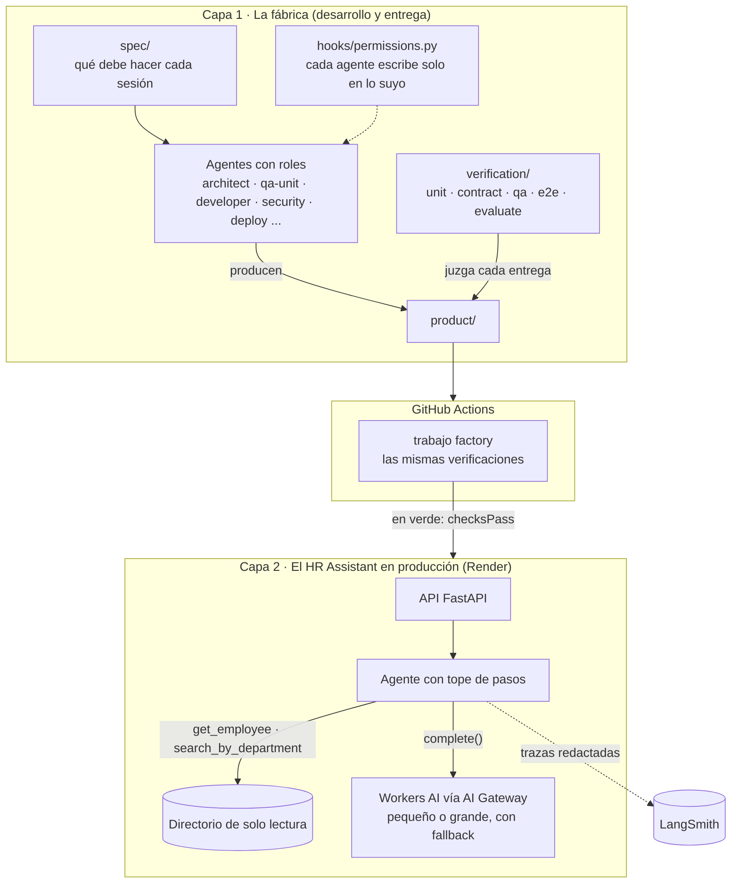

# 0020 · El sistema multi-agente en dos capas

Fecha: 2026-11-26 · Estado: aceptada · Reto de producción

## Contexto

El reto pide llevar a producción un «sistema multi-agente» y mostrar «una ejecución real de agentes». Este
repositorio tiene dos sistemas que trabajan juntos:

- Una **fábrica de agentes** (raíz del repositorio): especificaciones (`spec/`), diez agentes con roles y
  permisos (`.claude/agents/`, `hooks/permissions.py`), un orquestador (`/factory`) y las verificaciones que
  juzgan cada entrega (`verification/`).
- El **HR Assistant** (`product/`): un agente con bucle con tope y dos herramientas de solo lectura, que es lo
  que se despliega.

Presentar solo el segundo como «el sistema multi-agente» sería inexacto: en producción corre un agente.

## Decisión

El sistema se presenta en **dos capas**, cada una con su evidencia:

| Capa | Qué es | Cómo se ve funcionando |
| --- | --- | --- |
| 1 · La fábrica | El sistema multi-agente que especifica y juzga cada entrega: roles separados (quien escribe el código no escribe sus pruebas), permisos por agente, compuertas que deciden con su código de salida y aprobación humana para publicar | El trabajo `factory` del CI corre en cada push las verificaciones de la fábrica sobre el producto (`scripts/verify.py` y `verification unit`, `contract`, `qa`, `e2e`, `evaluate`); Render solo publica si pasa |
| 2 · El HR Assistant en producción | El agente que atiende `POST /ask`: decide en cada paso entre llamar una herramienta o responder, con tope de pasos, validación de su salida y fallback de modelo | El árbol de trazas en LangSmith por `request_id` (corrida → modelo → herramienta → modelo), el log JSON y `/metrics` |

Regla: ningún documento afirma que `/factory` generó este producto. La capa 1 se presenta como lo que
**especifica y juzga** cada entrega; el trabajo `factory` del CI es su evidencia en cada cambio.

## Consecuencias

- El video y el PR muestran las dos capas: el CI corriendo las verificaciones de la fábrica, y una ejecución real
  del agente con su traza en LangSmith.
- Las verificaciones de la fábrica no se tocan durante el reto (se comprueba con `--verificar` antes de cada
  entrega). Lo que el reto agrega lo cubren las pruebas del producto, que corren dentro de la verificación `unit`.

## Alternativa descartada

**Partir el HR Assistant en un supervisor y especialistas**, cada uno con su span: mostraría varios agentes en
producción, pero agrega llamadas al modelo (costo y latencia) sin una necesidad del dominio. Dos herramientas de
solo lectura no justifican un supervisor. Queda como opción si el asistente crece (por ejemplo, un especialista en
políticas de RH con su propia fuente).
