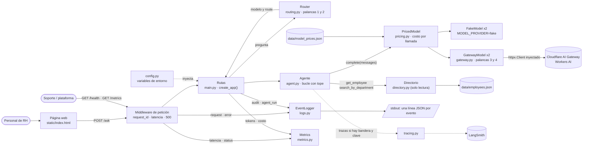

# Arquitectura del HR Assistant · Sesión 3

Asistente de Recursos Humanos que responde preguntas sobre empleados desde una página web. Es una API FastAPI
**sin estado** con **un agente** de bucle con tope y dos herramientas de solo lectura. Cada petición se puede
**rastrear y medir** (sesión 2). Desde la sesión 3 el agente puede usar un **modelo real** (Cloudflare Workers AI
vía AI Gateway) y cada respuesta **dice qué modelo usó y cuánto costó**, con cuatro palancas de costo medidas
contra una línea base.

Decisiones:

- [ADR 0001](adr/0001-stateless-api.md): API sin estado.
- [ADR 0002](adr/0002-model-interface-and-json-protocol.md): interfaz del modelo, protocolo JSON y bucle con tope.
- [ADR 0003](adr/0003-dependency-injection-and-startup-config.md): inyección de dependencias y configuración.
- [ADR 0004](adr/0004-request-id-and-json-logs.md): `request_id` y log JSON por evento.
- [ADR 0005](adr/0005-process-metrics-and-slo.md): métricas por proceso y SLO.
- [ADR 0006](adr/0006-optional-langsmith-tracing.md): trazas opcionales en LangSmith.
- [ADR 0007](adr/0007-rule-based-routing-and-history-window.md): enrutamiento por regla y ventana de historial.
- [ADR 0008](adr/0008-gateway-model-cache-and-cost-accounting.md): modelo real, caché y costo por llamada.
- [ADR 0009](adr/0009-secrets-and-env-example.md): secretos solo en el entorno y `.env.example`.

## Componentes



| Módulo | Responsabilidad |
| --- | --- |
| `app/main.py` | `create_app()` con dependencias inyectadas; middleware; rutas `/`, `/health`, `/ask` y `/metrics`; `502` si el modelo falla |
| `app/routing.py` | Regla de enrutamiento (modelo y `route`) y ventana de historial |
| `app/schemas.py` | Modelos Pydantic de la API: historial, cuerpo de `/ask` y `AskResponse` |
| `app/agent.py` | Bucle con tope, protocolo JSON, lista blanca, tokens, costo, llamadas cacheadas y aviso por herramienta |
| `app/llm.py` | Interfaz `complete(messages)`, `Completion`, `FakeModel` y `build_models()` |
| `app/gateway.py` | Workers AI vía AI Gateway: petición, tope de salida, caché, `usage`, adaptador al protocolo y `ModelUnavailable` |
| `app/pricing.py` | Precios por modelo y `PricedModel` |
| `app/directory.py` | Carga y consulta de solo lectura de los empleados |
| `app/config.py` | Configuración desde el entorno por grupos, con valores por omisión y validación al arrancar |
| `app/clock.py` | Reloj inyectable: hora UTC y tiempo monótono para latencias |
| `app/logs.py` | Una línea JSON por evento, con candado entre hilos |
| `app/metrics.py` | Contadores del proceso, percentiles, tokens, costo y SLO, con candado entre hilos |
| `app/tracing.py` | Enciende o apaga LangSmith y envuelve corrida, modelo y herramientas |
| `app/static/index.html` | Página única; historial en el navegador; pinta con `textContent`; muestra el «Id de soporte» |

## Flujo de una pregunta

```mermaid
sequenceDiagram
  participant P as Página
  participant W as Middleware
  participant A as Ruta /ask
  participant R as Router
  participant G as Agente
  participant M as Modelo (con precio)
  participant D as Directorio
  participant L as Log (stdout)
  P->>W: POST /ask {question, history} [X-Request-ID]
  W->>W: request_id y hora de inicio
  W->>A: petición
  A->>A: valida (422 si no cumple)
  A->>R: choose(question)
  R-->>A: modelo (pequeño o grande) y route
  A->>A: últimos HISTORY_WINDOW mensajes
  A->>G: run(question, history recortado) con el modelo elegido
  loop hasta AGENT_MAX_STEPS
    G->>M: complete(messages)
    M-->>G: JSON, tokens, cached, cost_usd
    alt pide herramienta
      G->>D: get_employee / search_by_department
      G->>L: audit (tool_call)
    else responde
      G-->>A: AgentResult (con costo y llamadas cacheadas)
    end
  end
  A->>L: agent_run (conteos, tokens, model, route, cost_usd; sin texto)
  A-->>W: AskResponse (answer, ..., request_id, model, route, cached_calls, cost_usd)
  W->>L: request
  W-->>P: respuesta + X-Request-ID
```

Si el modelo real falla (HTTP, timeout o formato), la ruta responde
`502 {"detail": "model unavailable", "request_id": ...}` y el log registra `error` con `error_type`. Cualquier otra
falla sigue siendo un `500` genérico.

## Costos

| Palanca | Cómo funciona | Configuración |
| --- | --- | --- |
| 1. Enrutamiento | Regla en código: grande si `ROUTING=false`, pregunta larga o palabra clave; si no, pequeño | `ROUTING`, `ROUTER_MAX_CHARS`, `MODEL_SMALL`, `MODEL_LARGE` |
| 2. Ventana | Solo los últimos N mensajes del historial llegan al modelo | `HISTORY_WINDOW` |
| 3. Tope de salida | `max_tokens` en cada llamada al modelo real | `MODEL_MAX_TOKENS` |
| 4. Caché | `cf-aig-cache-ttl`; un `HIT` del gateway cuesta 0 | `CACHE_TTL_SECONDS` |

`cost_usd` = (tokens de entrada × precio de entrada + tokens de salida × precio de salida) / 1 000 000, por
llamada y según el nombre del modelo (`data/model_prices.json`). Con `fake` hay dos modelos simulados con los
nombres de `MODEL_SMALL` y `MODEL_LARGE`: responden igual y cuestan según su nombre, así las palancas se miden sin
red. `verification evaluate` compara la línea base (`ROUTING=false`, sin ventana) con la configuración por
omisión: pasa solo si la calidad no baja y el costo sí baja.

## Observabilidad

| Pregunta | Dónde se contesta |
| --- | --- |
| ¿Qué pasó con la petición X? | Log: `grep` del `request_id` (el «Id de soporte» de la página) → `audit`, `agent_run`, `request`, `error` |
| ¿Qué herramientas usó el agente y con qué argumentos? | Eventos `audit` |
| ¿Qué modelo atendió la pregunta, por qué y cuánto costó? | Respuesta de `/ask` y evento `agent_run` (`model`, `route`, `cached_calls`, `cost_usd`) |
| ¿Está lento o fallando este proceso? | `GET /metrics`: `requests`, `error_rate`, p50/p95, `slo.met` |
| ¿Cuánto se ha gastado? | `GET /metrics`: `tokens` y `cost_usd` acumulados |
| ¿Cómo razonó el agente paso a paso? | LangSmith (si está encendido), buscando por los metadatos `request_id`, `model` y `route` |

## Configuración

| Variable | Por omisión | Regla |
| --- | --- | --- |
| `MODEL_PROVIDER` | `fake` | `fake` o `gateway` |
| `AGENT_MAX_STEPS` | `3` | Entero >= 1 |
| `MAX_QUESTION_CHARS` | `2000` | Entero >= 1 |
| `EMPLOYEES_PATH` | `data/employees.json` | Relativa a `product/`; el archivo debe existir y ser JSON válido |
| `SERVICE_NAME` | `hr-assistant` | Campo `service` del log |
| `SLO_P95_MS` | `2000` | Entero >= 1; meta del p95 en milisegundos |
| `LANGSMITH_TRACING` | `false` | `true` o `false`; enciende las trazas solo si además existe la clave |
| `HIDE_INPUTS` / `HIDE_OUTPUTS` | `true` | `true` o `false`; no mandar a LangSmith el texto |
| `LANGSMITH_API_KEY` | (sin valor) | Secreto; lo lee el cliente de LangSmith; nunca se registra |
| `CF_ACCOUNT_ID` | (vacía) | Obligatoria con `gateway` |
| `CF_GATEWAY_ID` | `default` | Obligatoria con `gateway` |
| `CF_API_TOKEN` | (vacía) | Secreto; obligatoria con `gateway`; nunca se registra |
| `MODEL_SMALL` | `@cf/meta/llama-3.1-8b-instruct-fast` | Debe tener precio |
| `MODEL_LARGE` | `@cf/meta/llama-3.3-70b-instruct-fp8-fast` | Debe tener precio |
| `ROUTING` | `true` | `true` o `false` |
| `ROUTER_MAX_CHARS` | `80` | Entero >= 1 |
| `HISTORY_WINDOW` | `6` | Entero >= 0 |
| `MODEL_MAX_TOKENS` | `300` | Entero >= 1 |
| `MODEL_TEMPERATURE` | `0` | Número entre 0 y 2 |
| `MODEL_TIMEOUT_SECONDS` | `30` | Número > 0; tiempo máximo de una llamada al modelo real |
| `CACHE_TTL_SECONDS` | `0` | Entero >= 0; 0 apaga la caché |
| `PRICES_PATH` | `data/model_prices.json` | Relativa a `product/`; debe tener los dos modelos |

Un valor inválido impide arrancar con un mensaje claro, que nunca incluye un secreto. `product/.env.example` lista
todas las variables con los secretos vacíos.

## Propiedades

- **Sin estado**: escalar es correr más copias; el `pid` de `/health` y `/metrics` muestra qué copia contestó.
- **Acotado**: como máximo `AGENT_MAX_STEPS` llamadas al modelo por pregunta, cada una con tope de salida, timeout
  y una ventana de historial fija.
- **Mínima agencia**: dos herramientas de solo lectura, validadas antes de ejecutarse y auditadas.
- **Rastreable sin exponer datos**: el log y las trazas por omisión no llevan el texto de preguntas ni respuestas.
- **Costo visible**: cada respuesta y `/metrics` dicen cuánto costó; las palancas se adoptan solo si `evaluate` lo
  demuestra.
- **Seguro en la página**: las respuestas se pintan con `textContent`.

## Cómo se comprueba

Desde la raíz de la fábrica:

- `uv run python -m verification unit`: pruebas del producto con cobertura de 80 % o más.
- `uv run python -m verification contract`: contrato de las sesiones 1 a 3 contra el producto corriendo.
- `uv run python -m verification qa`: pylint, 88 columnas, sin emojis y documentos en su lugar.
- `uv run python -m verification e2e`: pruebas de Playwright de la página.
- `uv run python -m verification evaluate`: calidad y costo, línea base contra palancas.
