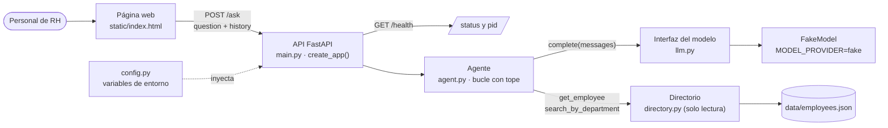
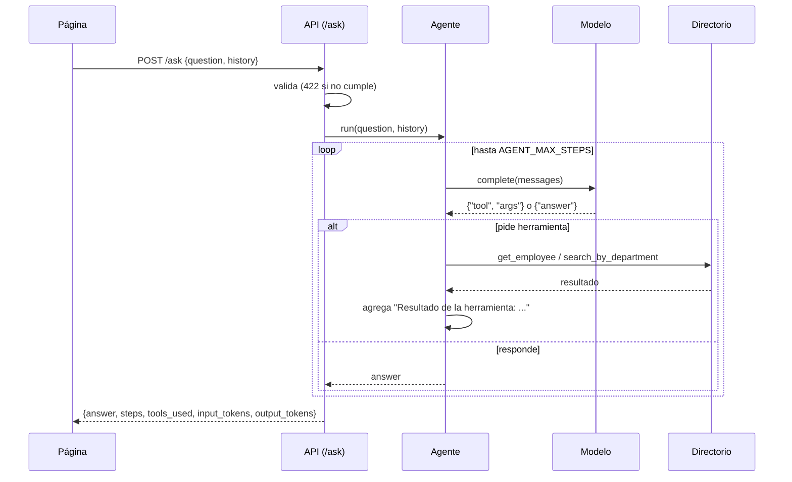

# Arquitectura del HR Assistant · Sesión 1

Asistente de Recursos Humanos que responde preguntas sobre empleados desde una página web. Es una API FastAPI
**sin estado** con **un agente** de bucle con tope, dos herramientas de solo lectura y un **modelo simulado**
detrás de una interfaz. Decisiones: [ADR 0001](adr/0001-stateless-api.md),
[ADR 0002](adr/0002-model-interface-and-json-protocol.md) y
[ADR 0003](adr/0003-dependency-injection-and-startup-config.md).

## Componentes

| Módulo | Responsabilidad |
| --- | --- |
| `app/main.py` | `create_app()` con dependencias inyectadas; rutas `/`, `/health` y `/ask`; validación con Pydantic |
| `app/agent.py` | Bucle con tope, protocolo JSON, lista blanca de herramientas, tokens |
| `app/llm.py` | Interfaz `complete(messages)`, `FakeModel` y `build_model()` |
| `app/directory.py` | Carga y consulta de solo lectura de los empleados |
| `app/config.py` | Configuración desde el entorno, con valores por omisión y validación al arrancar |
| `app/static/index.html` | Página única; historial en el navegador; pinta con `textContent` |

## Flujo de una pregunta

Si el bucle llega al tope sin respuesta, el agente contesta:
`No pude completar la respuesta. Intenta con una pregunta más concreta.`

## Configuración

| Variable | Por omisión | Regla |
| --- | --- | --- |
| `MODEL_PROVIDER` | `fake` | Solo `fake` en esta sesión |
| `AGENT_MAX_STEPS` | `3` | Entero >= 1 |
| `MAX_QUESTION_CHARS` | `2000` | Entero >= 1 |
| `EMPLOYEES_PATH` | `data/employees.json` | Relativa a `product/`; el archivo debe existir y ser JSON válido |

Un valor inválido impide arrancar con un mensaje claro.

## Propiedades

- **Sin estado**: escalar es correr más copias; el `pid` de `/health` muestra qué copia contestó.
- **Acotado**: como máximo `AGENT_MAX_STEPS` llamadas al modelo por pregunta.
- **Mínima agencia**: dos herramientas de solo lectura, validadas antes de ejecutarse.
- **Seguro en la página**: las respuestas se pintan con `textContent`, nunca con `innerHTML`.

## Cómo se comprueba

Desde la raíz de la fábrica:

- `uv run python -m verification unit`: pruebas del producto con cobertura de 80 % o más.
- `uv run python -m verification contract`: contrato de la fábrica contra el producto corriendo.
