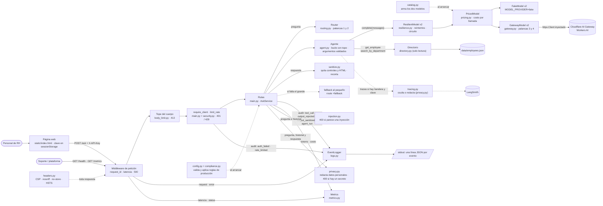
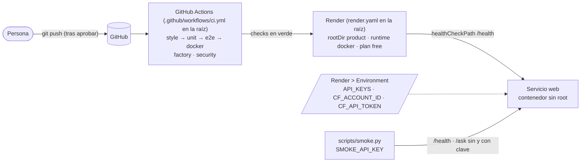

# Arquitectura del HR Assistant · Sesión 4

Asistente de Recursos Humanos que responde preguntas sobre empleados desde una página web. Es una API FastAPI
**sin estado** con **un agente** de bucle con tope y dos herramientas de solo lectura:

- **Rastreable y medible** (sesión 2): cada petición deja su rastro.
- **Con costo visible** (sesión 3): puede usar un **modelo real** (Cloudflare Workers AI vía AI Gateway) y cada
  respuesta dice qué modelo usó y cuánto costó.
- **Lista para producción** (sesión 4): acceso con **clave por cliente**, **límite de peticiones**, **reglas de
  compliance** que impiden arrancar mal configurado, un **contenedor**, un **pipeline de CI** visible y un
  **Blueprint de Render** que publica solo si el pipeline pasa.

Decisiones:

- [ADR 0001](adr/0001-stateless-api.md): API sin estado.
- [ADR 0002](adr/0002-model-interface-and-json-protocol.md): interfaz del modelo, protocolo JSON y bucle con tope.
- [ADR 0003](adr/0003-dependency-injection-and-startup-config.md): inyección de dependencias y configuración.
- [ADR 0004](adr/0004-request-id-and-json-logs.md): `request_id` y log JSON por evento.
- [ADR 0005](adr/0005-process-metrics-and-slo.md): métricas por proceso y SLO.
- [ADR 0006](adr/0006-optional-langsmith-tracing.md): trazas opcionales en LangSmith.
- [ADR 0007](adr/0007-rule-based-routing-and-history-window.md): enrutamiento por regla y ventana de historial.
- [ADR 0008](adr/0008-gateway-model-cache-and-cost-accounting.md): modelo real, caché y costo por llamada.
- [ADR 0009](adr/0009-secrets-and-env-example.md): secretos solo en el entorno y `.env.example`.
- [ADR 0010](adr/0010-api-keys-and-rate-limit.md): clave por cliente y límite de peticiones.
- [ADR 0011](adr/0011-compliance-as-code.md): compliance como código.
- [ADR 0012](adr/0012-container-ci-and-render.md): contenedor, CI encadenado y Blueprint de Render.
- [ADR 0013](adr/0013-input-and-output-validation.md): validación de entradas y de salidas.
- [ADR 0014](adr/0014-personal-data-secrets-and-redacted-traces.md): datos personales y secretos; trazas
  redactadas.
- [ADR 0015](adr/0015-root-ci-locked-dependencies-and-supply-chain.md): CI y Blueprint en la raíz, dependencias
  fijadas con hashes y cadena de suministro.
- [ADR 0016](adr/0016-injection-audit-and-http-hardening.md): prompt injection, auditoría completa, cabeceras de
  seguridad y topes de producción.
- [ADR 0017](adr/0017-request-origin-auth-throttling-and-budget.md): origen de las peticiones, límite de claves
  fallidas y presupuesto diario.
- [ADR 0018](adr/0018-model-resilience-retries-fallback-circuit-breaker.md): resiliencia del modelo real.
- [ADR 0019](adr/0019-concurrency-readiness-api-contract-and-environments.md): concurrencia, readiness, contrato
  de la API y entornos.
- [ADR 0020](adr/0020-two-layer-multi-agent-system.md): el sistema multi-agente en dos capas.

## El sistema en dos capas

La capa 1 es la fábrica de agentes, que especifica y juzga cada entrega; la capa 2 es el agente del HR Assistant
en producción. El diagrama y la evidencia de cada una están en el ADR 0020. El resto de este documento describe la
capa 2.

Controles de seguridad, amenazas y mínimo privilegio: [`security.md`](security.md).

## Componentes



| Módulo | Responsabilidad |
| --- | --- |
| `app/main.py` | `create_app()` con dependencias inyectadas; middleware; autenticación y límite como dependencias; rutas `/`, `/health`, `/ask` y `/metrics`; `AskService`; `502` si el modelo falla |
| `app/security.py` | `KeyStore` (cliente de una clave con `hmac.compare_digest`), `RateLimiter` (por cliente), `FailureLimiter` (claves fallidas por origen), `DailyBudget` (costo por cliente y día), `client_origin` y `OriginFingerprint` (huella HMAC del origen) |
| `app/compliance.py` | Reglas de producción: con `ENVIRONMENT=production` la aplicación no arranca si alguna falla |
| `app/routing.py` | Regla de enrutamiento (modelo y `route`) y ventana de historial |
| `app/schemas.py` | Modelos Pydantic de la API: cuerpo de `/ask` con sus límites (largo de la pregunta, mensajes del historial y largo por rol, sin caracteres prohibidos) y `AskResponse` |
| `app/body_limit.py` | Middleware ASGI: `413` si el cuerpo pasa de `MAX_BODY_BYTES`, por `Content-Length` o contando mientras llega |
| `app/sanitize.py` | Caracteres prohibidos en la entrada (controles, marcas bidireccionales y etiquetas) y limpieza de la respuesta (controles, HTML, largo); copia normalizada para los detectores (`detection_view`) |
| `app/privacy.py` | Detector de datos personales y secretos, redacción `[REDACTED:TIPO]`, `SecretFound` (`400`) y `redact_tree` para las trazas |
| `app/injection.py` | Siete reglas de prompt injection en español e inglés sobre una copia normalizada; `InjectionFound` (`400`) |
| `app/headers.py` | Cabeceras de seguridad de toda respuesta y CSP por ruta (la de la página, con los hashes de su script y su estilo) |
| `app/agent.py` | Bucle con tope, protocolo JSON, lista blanca, argumentos validados y normalizados (`EMP-0000`, departamentos de los datos), consumo (`Usage`) y avisos por herramienta y por respuesta rechazada |
| `app/catalog.py` | Arma el modelo pequeño y el grande (simulados o reales) envueltos en `PricedModel`, y valida sus precios |
| `app/llm.py` | Interfaz `complete(messages)`, `Completion` y `FakeModel` |
| `app/gateway.py` | Workers AI vía AI Gateway: petición, tope de salida, caché, `usage`, adaptador al protocolo y `ModelUnavailable` (transitoria o no, con `Retry-After`); timeout de conexión aparte |
| `app/resilience.py` | `Retrier` (reintentos con backoff, jitter, `Retry-After` y plazo), `CircuitBreaker` y `ResilientModel`; `ModelCircuitOpen` (`503`) |
| `app/api_docs.py` | Contrato OpenAPI: descripción, etiquetas y errores documentados de cada ruta |
| `app/pricing.py` | Precios por modelo y `PricedModel` |
| `app/directory.py` | Carga y consulta de solo lectura de los empleados |
| `app/config.py` | Configuración desde el entorno por grupos, con valores por omisión y validación al arrancar |
| `app/clock.py` | Reloj inyectable: hora UTC y tiempo monótono para latencias y el límite |
| `app/logs.py` | Una línea JSON por evento, con candado entre hilos |
| `app/metrics.py` | Contadores del proceso, percentiles, tokens, costo y SLO, con candado entre hilos |
| `app/tracing.py` | Enciende o apaga LangSmith, oculta o redacta entradas y salidas, y envuelve corrida, modelo y herramientas |
| `app/static/index.html` | Página única; clave en `sessionStorage`; historial en el navegador; pinta con `textContent`; «Id de soporte» |

**Cambio frente al plan de la sesión 3**: el plan ponía `build_models()` en `llm.py`. Como `pricing.py` y
`gateway.py` importan `Completion` de `llm.py`, eso creaba una importación circular; `build_models()` vive en
`app/catalog.py`. En la sesión 4, `model_provider` pasa a `settings.models.provider` (ADR 0003).

## Flujo de una pregunta

```mermaid
sequenceDiagram
  participant P as Página
  participant W as Middleware
  participant S as Seguridad
  participant A as AskService
  participant G as Agente
  participant M as Modelo (con precio)
  participant L as Log (stdout)
  P->>W: POST /ask {question, history} + X-API-Key [X-Request-ID]
  W->>W: request_id y hora de inicio
  W->>W: tope del cuerpo (MAX_BODY_BYTES)
  W->>S: require_client(X-API-Key)
  alt cuerpo de más
    W-->>P: 413 request body too large
  else sin clave o clave inválida
    S->>L: audit auth_failed (sin la clave)
    S-->>P: 401 invalid or missing API key
  else cliente sobre su límite
    S->>L: audit rate_limited
    S-->>P: 429 rate limit exceeded + Retry-After
  else permitido
    S->>A: cliente
    A->>A: valida (422: largo, historial, caracteres), enruta, recorta historial
    A->>G: run(question, history) con el modelo elegido
    G->>M: complete(messages) hasta AGENT_MAX_STEPS (reintentos y circuito por modelo)
    Note over A,M: si falla el modelo grande, se repite con el pequeño (route +fallback);<br/>con todos los circuitos abiertos, 503 con Retry-After
    G->>L: audit tool_call (args validados) u output_rejected (motivo)
    A->>A: limpia la respuesta (controles, HTML, MAX_ANSWER_CHARS)
    A->>L: audit output_sanitized si cambió algo (sin el texto)
    A->>L: agent_run (client, conteos, model, route, cost_usd; sin texto)
    A-->>W: AskResponse (answer, ..., request_id, model, route, cached_calls, cost_usd)
  end
  W->>L: request (client, method, path, status, latency_ms)
  W-->>P: respuesta + X-Request-ID
```

Si el modelo real falla, la respuesta es `502 {"detail": "model unavailable", "request_id": ...}`; cualquier otra
falla, `500` genérico. Al arrancar, `load_settings()` valida los valores (incluida la forma de `API_KEYS`) y
`compliance` aplica las reglas de producción.

## Despliegue



| Pieza | Archivo | Qué garantiza |
| --- | --- | --- |
| Contenedor | `Dockerfile`, `.dockerignore` | `python:3.12-slim`, solo el lock de ejecución con hashes, usuario sin privilegios, solo `app/` y `data/`, `--no-access-log`, `HEALTHCHECK` |
| Dependencias | `requirements.txt`, `requirements-dev.txt` (y sus `.in`) | Ejecución y desarrollo separados; todo fijado con hashes (`uv pip compile --universal`) |
| Pipeline | `.github/workflows/ci.yml` (raíz) | `style → unit → e2e → docker` encadenados, más `factory` (verificaciones de la fábrica) y `security` (pip-audit y gitleaks); acciones por SHA |
| Publicación | `render.yaml` (raíz) | `rootDir: product`; servicio con el nombre del repositorio; despliega solo con checks en verde; secretos con `sync: false` |
| Prueba de humo | `scripts/smoke.py` | `/health` 200, `/ask` sin clave 401, `/ask` con clave 200 |
| Reglas | `doc/compliance-checklist.md` | Cada regla de producción, dónde está en el código y cómo se comprueba |

El CI y el Blueprint viven en la raíz del repositorio, donde GitHub y Render los buscan; el producto está en
`product/` (ADR 0015).

## Costos

| Palanca | Cómo funciona | Configuración |
| --- | --- | --- |
| 1. Enrutamiento | Regla en código: grande si `ROUTING=false`, pregunta larga o palabra clave; si no, pequeño | `ROUTING`, `ROUTER_MAX_CHARS`, `MODEL_SMALL`, `MODEL_LARGE` |
| 2. Ventana | Solo los últimos N mensajes del historial llegan al modelo | `HISTORY_WINDOW` |
| 3. Tope de salida | `max_tokens` en cada llamada al modelo real | `MODEL_MAX_TOKENS` |
| 4. Caché | `cf-aig-cache-ttl`; un `HIT` del gateway cuesta 0 | `CACHE_TTL_SECONDS` |

`cost_usd` = (tokens de entrada × precio de entrada + tokens de salida × precio de salida) / 1 000 000, por
llamada y según el nombre del modelo (`data/model_prices.json`). `verification evaluate` compara la línea base
(`ROUTING=false`, sin ventana) con la configuración por omisión: pasa solo si la calidad no baja y el costo sí baja.
El límite por cliente (ADR 0010) también acota el gasto.

## Observabilidad

| Pregunta | Dónde se contesta |
| --- | --- |
| ¿Qué pasó con la petición X? | Log: `grep` del `request_id` (el «Id de soporte» de la página) → `audit`, `agent_run`, `request`, `error` |
| ¿Quién preguntó? | Campo `client` en `request`, `agent_run`, `audit` y en los metadatos de la traza |
| ¿Quién intentó entrar sin permiso o abusó? | `audit` con `auth_failed` y `rate_limited` |
| ¿Qué herramientas usó el agente y con qué argumentos? | `audit` con `tool_call` |
| ¿Qué modelo atendió la pregunta, por qué y cuánto costó? | Respuesta de `/ask` y evento `agent_run` |
| ¿Está lento o fallando este proceso? | `GET /metrics` (con clave): `requests`, `error_rate`, p50/p95, `slo.met` |
| ¿Cuánto se ha gastado? | `GET /metrics`: `tokens` y `cost_usd` acumulados |
| ¿Cómo razonó el agente paso a paso? | LangSmith (si está encendido), por los metadatos `request_id`, `client`, `model` y `route` |

## Configuración

| Variable | Por omisión | Regla |
| --- | --- | --- |
| `ENVIRONMENT` | `development` | `development` o `production` (aplica las reglas de compliance) |
| `API_KEYS` | (vacía) | Secreto; `cliente:clave,...`; en producción, claves de 16 caracteres o más |
| `RATE_LIMIT_PER_MINUTE` | `30` | Entero >= 1; peticiones a `/ask` por cliente por minuto |
| `AUTH_FAILURES_PER_MINUTE` | `10` | Entero >= 1; claves fallidas por origen por minuto |
| `TRUSTED_PROXY_HOPS` | `0` | Entero >= 0; `1` en Render |
| `CLIENT_DAILY_BUDGET_USD` | `1.0` | Número >= 0; en producción, mayor que 0 |
| `MODEL_PROVIDER` | `fake` | `fake` o `gateway`; en producción, `gateway` |
| `AGENT_MAX_STEPS` | `3` | Entero >= 1 |
| `MAX_QUESTION_CHARS` | `2000` | Entero >= 1; también tope de cada mensaje `user` del historial |
| `MAX_HISTORY_MESSAGES` | `20` | Entero >= 0 |
| `MAX_ANSWER_CHARS` | `2000` | Entero >= 100; tope de la respuesta y de cada mensaje `assistant` del historial |
| `MAX_BODY_BYTES` | `65536` | Entero >= 1024 |
| `EMPLOYEES_PATH` | `data/employees.json` | Relativa a `product/`; el archivo debe existir y ser JSON válido |
| `SERVICE_NAME` | `hr-assistant` | Campo `service` del log |
| `SLO_P95_MS` | `2000` | Entero >= 1; meta del p95 en milisegundos |
| `LANGSMITH_TRACING` | `false` | `true` o `false`; enciende las trazas solo si además existe la clave |
| `HIDE_INPUTS` / `HIDE_OUTPUTS` | `true` | `true` (ocultar), `redact` (redactar) o `false` (en claro); en producción con trazas, nunca `false` |
| `LANGSMITH_API_KEY` | (sin valor) | Secreto; lo lee el cliente de LangSmith; nunca se registra |
| `CF_ACCOUNT_ID` | (vacía) | Obligatoria con `gateway` |
| `CF_GATEWAY_ID` | `default` | Obligatoria con `gateway` |
| `CF_API_TOKEN` | (vacía) | Secreto; obligatoria con `gateway`; nunca se registra |
| `MODEL_SMALL` | `@cf/meta/llama-3.1-8b-instruct-fast` | Debe tener precio |
| `MODEL_LARGE` | `@cf/meta/llama-3.3-70b-instruct-fp8-fast` | Debe tener precio |
| `ROUTING` | `true` | `true` o `false` |
| `ROUTER_MAX_CHARS` | `80` | Entero >= 1 |
| `HISTORY_WINDOW` | `6` | Entero >= 0 |
| `MODEL_MAX_TOKENS` | `300` | Entero >= 1 |
| `MODEL_TEMPERATURE` | `0` | Número entre 0 y 2 |
| `MODEL_TIMEOUT_SECONDS` | `30` | Número > 0; también el plazo de los reintentos |
| `MODEL_CONNECT_TIMEOUT_SECONDS` | `5` | Número > 0 |
| `MODEL_MAX_RETRIES` | `2` | Entero >= 0 |
| `MODEL_RETRY_BACKOFF_SECONDS` | `0.5` | Número >= 0 |
| `CIRCUIT_FAILURE_THRESHOLD` | `5` | Entero >= 1 |
| `CIRCUIT_OPEN_SECONDS` | `30` | Número > 0 |
| `CACHE_TTL_SECONDS` | `0` | Entero >= 0; 0 apaga la caché |
| `PRICES_PATH` | `data/model_prices.json` | Relativa a `product/`; debe tener los dos modelos |
| `PORT` | `8000` | Puerto del contenedor (Render lo define) |

Un valor inválido o una configuración de producción que no cumple impiden arrancar, con un mensaje que nunca
incluye un secreto. `product/.env.example` lista todas las variables con los secretos vacíos.

## Propiedades

- **Defensa en capas contra la inyección**: heurísticas que bloquean antes del modelo, agente con dos herramientas
  de solo lectura y argumentos validados, tope de pasos y salida limpia y redactada (ADR 0013, 0014 y 0016).
- **Auditable**: cada acción relevante deja una línea `audit` sin texto ni secretos, incluido el arranque.

- **Resiliente**: reintentos ante fallas transitorias, circuit breaker por modelo, fallback del grande al pequeño
  y `/ready` que lo refleja (ADR 0018 y 0019).
- **Concurrente**: rutas en el pool de hilos con estado compartido bajo candado; medido con `scripts/load_test.py`.
- **Sin estado**: escalar es correr más copias; el `pid` de `/health` y `/metrics` muestra qué copia contestó (el
  límite de peticiones es por copia).
- **Acotado**: como máximo `AGENT_MAX_STEPS` llamadas al modelo por pregunta, cada una con tope de salida y
  timeout, una ventana de historial fija y un límite de peticiones por cliente.
- **Mínima agencia**: dos herramientas de solo lectura, validadas antes de ejecutarse y auditadas.
- **Entradas acotadas, salidas limpias**: el cuerpo, el historial y cada mensaje tienen tope; la respuesta sale
  sin caracteres de control ni HTML y con largo máximo (ADR 0013).
- **Datos personales fuera del modelo y de las trazas**: se redactan antes del modelo, en la respuesta y en
  LangSmith; un secreto en la petición la bloquea (ADR 0014).
- **Acceso controlado**: clave por cliente comparada en tiempo constante; la clave nunca se registra; las fallas
  se limitan por origen antes de comparar y cada cliente tiene presupuesto diario (ADR 0017).
- **Rastreable sin exponer datos**: el log y las trazas por omisión no llevan el texto de preguntas ni respuestas.
- **Costo visible**: cada respuesta y `/metrics` dicen cuánto costó.
- **Seguro al desplegar**: producción no arranca si incumple una regla; Render publica solo con el CI en verde.
- **Seguro en la página**: las respuestas se pintan con `textContent`; la clave vive en `sessionStorage`.

## Cómo se comprueba

Desde la raíz de la fábrica:

- `uv run python -m verification unit`: pruebas del producto con cobertura de 80 % o más.
- `uv run python -m verification contract`: contrato de las sesiones 1 a 4 contra el producto corriendo.
- `uv run python -m verification qa`: pylint, 88 columnas, sin emojis y documentos en su lugar.
- `uv run python -m verification e2e`: pruebas de Playwright de la página, con clave.
- `uv run python -m verification evaluate`: calidad y costo, línea base contra palancas.
- `uv run python -m verification production <url>`: prueba de humo contra Render, con `SMOKE_API_KEY` (después de
  publicar).
