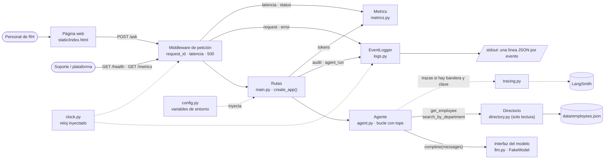

# Arquitectura del HR Assistant · Sesión 2

Asistente de Recursos Humanos que responde preguntas sobre empleados desde una página web. Es una API FastAPI
**sin estado** con **un agente** de bucle con tope, dos herramientas de solo lectura y un **modelo simulado**
detrás de una interfaz. Desde la sesión 2 cada petición se puede **rastrear y medir**: `request_id`, log JSON,
auditoría de herramientas, `/metrics` con SLO y trazas opcionales en LangSmith.

Decisiones:

- [ADR 0001](adr/0001-stateless-api.md): API sin estado.
- [ADR 0002](adr/0002-model-interface-and-json-protocol.md): interfaz del modelo, protocolo JSON y bucle con tope.
- [ADR 0003](adr/0003-dependency-injection-and-startup-config.md): inyección de dependencias y configuración.
- [ADR 0004](adr/0004-request-id-and-json-logs.md): `request_id` y log JSON por evento.
- [ADR 0005](adr/0005-process-metrics-and-slo.md): métricas por proceso y SLO.
- [ADR 0006](adr/0006-optional-langsmith-tracing.md): trazas opcionales en LangSmith.

## Componentes



| Módulo | Responsabilidad |
| --- | --- |
| `app/main.py` | `create_app()` con dependencias inyectadas; middleware de petición; rutas `/`, `/health`, `/ask` y `/metrics` |
| `app/schemas.py` | Modelos Pydantic de la API: historial, cuerpo de `/ask` con el largo configurado y `AskResponse` |
| `app/agent.py` | Bucle con tope, protocolo JSON, lista blanca de herramientas, tokens, `stopped` y aviso por herramienta |
| `app/llm.py` | Interfaz `complete(messages)`, `FakeModel` y `build_model()` |
| `app/directory.py` | Carga y consulta de solo lectura de los empleados |
| `app/config.py` | Configuración desde el entorno, con valores por omisión y validación al arrancar |
| `app/clock.py` | Reloj inyectable: hora UTC y tiempo monótono para latencias |
| `app/logs.py` | Una línea JSON por evento, con candado entre hilos |
| `app/metrics.py` | Contadores del proceso, percentiles, tokens y SLO, con candado entre hilos |
| `app/tracing.py` | Enciende o apaga LangSmith y envuelve corrida, modelo y herramientas |
| `app/static/index.html` | Página única; historial en el navegador; pinta con `textContent`; muestra el «Id de soporte» |

## Flujo de una pregunta

```mermaid
sequenceDiagram
  participant P as Página
  participant W as Middleware
  participant A as Ruta /ask
  participant G as Agente
  participant M as Modelo
  participant D as Directorio
  participant L as Log (stdout)
  P->>W: POST /ask {question, history} [X-Request-ID]
  W->>W: request_id (del cliente si es válido, si no UUID) y hora de inicio
  W->>A: petición
  A->>A: valida (422 si no cumple)
  A->>G: run(question, history, on_tool_call) en el contexto de trazas
  loop hasta AGENT_MAX_STEPS
    G->>M: complete(messages)
    M-->>G: {"tool", "args"} o {"answer"}
    alt pide herramienta
      G->>D: get_employee / search_by_department
      D-->>G: resultado
      G->>L: audit (tool_call, tool, args) vía on_tool_call
    else responde
      G-->>A: AgentResult
    end
  end
  A->>L: agent_run (conteos, tokens, stopped; sin texto)
  A-->>W: AskResponse con request_id
  W->>L: request (method, path, status, latency_ms)
  W-->>P: respuesta + X-Request-ID
```

Si algo truena, el middleware escribe `error` (solo `error_type`) y responde
`500 {"detail": "internal error", "request_id": ...}` con `X-Request-ID`.

## Observabilidad

| Pregunta | Dónde se contesta |
| --- | --- |
| ¿Qué pasó con la petición X? | Log: `grep` del `request_id` (el «Id de soporte» de la página) → `audit`, `agent_run`, `request`, `error` |
| ¿Qué herramientas usó el agente y con qué argumentos? | Eventos `audit` |
| ¿Está lento o fallando este proceso? | `GET /metrics`: `requests`, `error_rate`, p50/p95, `slo.met` |
| ¿Cuántos tokens se gastaron? | `GET /metrics` (`tokens`) y cada `agent_run` |
| ¿Cómo razonó el agente paso a paso? | LangSmith (si está encendido), buscando por el metadato `request_id` |

## Configuración

| Variable | Por omisión | Regla |
| --- | --- | --- |
| `MODEL_PROVIDER` | `fake` | Solo `fake` por ahora |
| `AGENT_MAX_STEPS` | `3` | Entero >= 1 |
| `MAX_QUESTION_CHARS` | `2000` | Entero >= 1 |
| `EMPLOYEES_PATH` | `data/employees.json` | Relativa a `product/`; el archivo debe existir y ser JSON válido |
| `SERVICE_NAME` | `hr-assistant` | Campo `service` del log |
| `SLO_P95_MS` | `2000` | Entero >= 1; meta del p95 en milisegundos |
| `LANGSMITH_TRACING` | `false` | `true` o `false`; enciende las trazas solo si además existe la clave |
| `HIDE_INPUTS` / `HIDE_OUTPUTS` | `true` | `true` o `false`; no mandar a LangSmith el texto |
| `LANGSMITH_API_KEY` | (sin valor) | Secreto; lo lee el cliente de LangSmith; nunca se registra |

Un valor inválido impide arrancar con un mensaje claro.

## Propiedades

- **Sin estado**: escalar es correr más copias; el `pid` de `/health` y `/metrics` muestra qué copia contestó.
- **Acotado**: como máximo `AGENT_MAX_STEPS` llamadas al modelo por pregunta; latencias en una ventana fija.
- **Mínima agencia**: dos herramientas de solo lectura, validadas antes de ejecutarse y auditadas.
- **Rastreable sin exponer datos**: el log y las trazas por omisión no llevan el texto de preguntas ni respuestas.
- **Seguro en la página**: las respuestas se pintan con `textContent`.

## Cómo se comprueba

Desde la raíz de la fábrica:

- `uv run python -m verification unit`: pruebas del producto con cobertura de 80 % o más.
- `uv run python -m verification contract`: contrato de las sesiones 1 y 2 contra el producto corriendo.
- `uv run python -m verification qa`: pylint, 88 columnas, sin emojis y documentos en su lugar.
