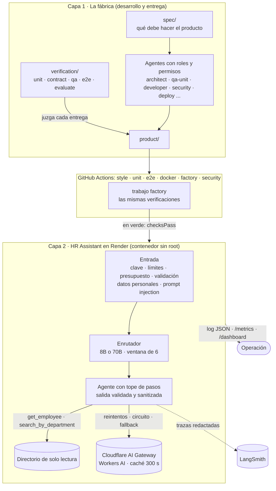

# feat: Sistema multi-agente listo para producción con observabilidad, costos y seguridad

**Participante:** <nombre completo>

## Resumen de cambios

El HR Assistant responde preguntas del personal de Recursos Humanos sobre empleados con un agente que consulta un
directorio de solo lectura. Para llevarlo a producción, se publicó en Render con un contenedor sin privilegios y un
CI de seis trabajos que incluye las verificaciones de la fábrica de agentes. También se agregaron trazas en
LangSmith, métricas, dashboard y runbook; cuatro palancas de costo que, con el modelo real, bajan el costo 85.9 %
sin bajar la calidad; y 21 controles de seguridad con auditoría. El sistema final es resiliente a fallas del modelo, impide arrancar con una configuración
insegura y deja cada petición rastreable por su `request_id`.

## Arquitectura del sistema

El sistema multi-agente tiene dos capas: la **fábrica**, que especifica y juzga cada entrega, y el **HR
Assistant**, el agente que atiende a las personas en producción (ADR 0020). Detalle, componentes y flujo:
`product/doc/architecture.md`.

**Flujo de comunicación**

1. La persona de RH escribe su pregunta en la página. La petición viaja con la clave de su cliente y recibe un
   `request_id` que la acompaña en el log, las métricas, la traza y el AI Gateway.
2. Antes de leer la pregunta, el servicio revisa:
   - el tamaño del cuerpo;
   - las claves fallidas desde ese origen;
   - la clave, comparada en tiempo constante;
   - el límite por minuto y el presupuesto diario del cliente.
3. Valida la pregunta y el historial (largos y caracteres permitidos). Un secreto o una inyección detienen la
   petición sin llamar al modelo; los datos personales se redactan.
4. Una regla en código elige el modelo pequeño (8B) o el grande (70B), y solo los últimos 6 mensajes del
   historial llegan al modelo.
5. En cada paso, hasta un tope, el agente decide si llama a una de sus dos herramientas de solo lectura o si
   responde. Sus argumentos se validan contra una lista blanca y una forma fija.
6. Cada llamada al modelo pasa por reintentos y un circuit breaker, y llega al AI Gateway con dos credenciales y
   la caché de 5 minutos. Si el modelo grande falla, responde el pequeño.
7. La respuesta sale sanitizada, redactada y recortada, con el modelo usado, la ruta y su costo.
8. Cada evento queda en el log JSON (con auditoría), en las métricas y en el árbol de trazas de LangSmith.
9. En cada push, la capa 1 juzga el cambio: el CI corre las verificaciones de la fábrica, Render publica solo si
   todo pasa, y la aplicación no arranca si su configuración de producción es insegura.

**Decisiones clave**

| Decisión | Por qué | ADR |
| --- | --- | --- |
| API sin estado con inyección de dependencias | Escala horizontal y pruebas sin red | 0001, 0003 |
| Un agente con dos herramientas de solo lectura, no supervisor y especialistas | El dominio no lo necesita; menos llamadas, costo y superficie de ataque | 0002, 0020 |
| Sistema en dos capas, con el trabajo `factory` obligatorio en el CI | La fábrica juzga cada entrega; Render no publica si falla | 0020 |
| Enrutamiento por regla y ventana de historial | El mayor ahorro sin otro modelo que decida; determinista y explicable | 0007 |
| Caché del gateway de 5 minutos con clave por hash del cuerpo | Ahorra costo y latencia sin mezclar clientes; nunca más de 15 minutos | 0022 |
| Trazas redactadas, no ocultas | Depurar en LangSmith sin exponer datos personales | 0014 |
| Compliance como código | Producción no arranca con el modelo simulado, claves cortas, trazas en claro ni topes quitados | 0011, 0016 |
| Reintentos, circuit breaker y fallback | Una caída del modelo no tumba el servicio | 0018 |
| CI y Blueprint en la raíz; dependencias con hashes; acciones por SHA | Cadena de suministro reproducible y verificable | 0015 |
| Observabilidad unida por `request_id` | De una queja a su traza, su log y su costo en un paso | 0004, 0021 |

## Instalación y ejecución

Ver `product/README.md`: requisitos, instalación (PowerShell y Bash), variables de entorno,
ejecución local con el modelo simulado y el real, Docker, despliegue en Render y pruebas.

URL pública: <URL pública> (el plan gratuito de Render duerme el servicio tras 15 minutos; la primera petición
tarda hasta un minuto). `GET /health`, `GET /docs` (Swagger con **Authorize**) y `GET /ready` no piden clave.

## Observabilidad

- **LangSmith:**
  - Proyectos `m4-hr-assistant-dev` (local) y `m4-hr-assistant-prod` (Render).
  - Cada pregunta es un árbol `ask` → `agent_run` → `model` → herramienta → `model`.
  - Los metadatos son `request_id`, `client`, `model`, `route`, `fallback`, `cost_usd` y `cached_calls`, más los
    tokens de cada llamada. El texto va redactado.
  - Corrida con el modelo real (2026-11-26, `product/doc/evidence/langsmith-local.txt`):
    - La pregunta simple va al modelo de 8B.
    - La que pide comparar va al de 70B y usa tres herramientas.
    - La que trae una CURP sintética llega redactada a la traza.
    - La inyección responde `400`.
  - Capturas: `langsmith-trace.png` y `langsmith-dashboard.png`.
- **Logs:** una línea JSON por evento con `request_id`, nivel, entorno y versión, y 13 acciones de auditoría. No
  llevan texto de las personas, claves ni IP. La cabecera `X-Request-ID` va en toda respuesta.
- **Métricas:**
  - `GET /metrics`: latencia p50/p95/p99 contra el SLO, `error_rate`, tokens y costo.
  - Desgloses por código, modelo, ruta y cliente, `cache_hit_rate`, contadores de seguridad y métricas de
    negocio.
  - `GET /dashboard` las muestra en tarjetas y tablas.
- **Runbook:** `product/doc/observability.md` explica cómo seguir una petición,
  investigar un aumento de costo, un 502/503, un 429 o un ataque, y los umbrales de alerta.

## Optimización de costos

Cuatro palancas activas en producción (`render.yaml`): enrutamiento 8B/70B, ventana de 6 mensajes, tope de
300 tokens de salida y caché del gateway de 300 s, más un presupuesto diario por cliente. Línea base: modelo
grande, historial completo y sin caché.

Con el modelo simulado (`verification evaluate` y `scripts/cost_ablation.py`, mismo set de 8 preguntas):

| Configuración | Calidad | Costo (USD) | Tokens de entrada | Ahorro |
| --- | --- | --- | --- | --- |
| Línea base | 100 % | 0.001134 | 2416 | — |
| Solo ventana de 6 | 100 % | 0.000967 | 1846 | 14.7 % |
| Solo enrutamiento | 100 % | 0.000181 | 2416 | 84.0 % |
| Producción (las dos) | 100 % | 0.000156 | 1846 | 86.2 % |

Con el modelo real (`scripts/cost_real_sample.py`, 2026-11-26; `product/doc/evidence/cost-real-model.md`), el
mismo set:

| Configuración | Calidad | Costo (USD) | Tokens de entrada | Ahorro | p50 |
| --- | --- | --- | --- | --- | --- |
| Línea base: 70B, historial completo, sin caché | 100 % | 0.002646 | 5556 | — | 1707 ms |
| Producción, sin caché | 100 % | 0.000374 | 4476 | 85.9 % | 687 ms |
| Producción, pregunta repetida (15 de 15 llamadas desde la caché) | 100 % | 0.000000 | 4476 | 100 % | 87 ms |

- **El simulado predijo el ahorro:** −86.2 % simulado frente a −85.9 % real.
- **El tope de 300 tokens no se alcanzó:** la salida máxima fue de 77 tokens por petición. Es una red de
  seguridad.

Proyección con 1 000 peticiones al día:

- La línea base costaría 9.92 USD al mes; producción, 1.40 USD.
- Producción usa unas 4 250 neuronas al día y cabe en las 10 000 gratis de Workers AI. La línea base necesitaría
  unas 30 100.

Trade-offs por palanca, la palanca que no se aceptaría aunque bajara el costo (ventana 0) y cómo se vigila el
costo: `product/doc/cost-analysis.md`.

## Seguridad

Defensa en capas: lo que una capa no detiene, lo contiene la siguiente. Detalle, modelo de amenazas, matriz de
mínimo privilegio y rotación de secretos: `product/doc/security.md`.

| # | Control | Riesgo (OWASP LLM 2025) | Evidencia |
| --- | --- | --- | --- |
| 1 | Validación de entradas: cuerpo, largo, historial, caracteres invisibles | LLM01, LLM10 | `security-check.txt`; `tests/test_validation.py` |
| 2 | Detección de prompt injection (7 reglas ES/EN, también en el historial) | LLM01, LLM07 | `security-check.txt`; auditoría `injection_blocked` |
| 3 | Datos personales redactados antes del modelo, en la respuesta y en las trazas | LLM02 | `security-check.txt`; auditoría `pii_detected` |
| 4 | Secretos en la petición: `400` | LLM02 | `security-check.txt`; auditoría `secret_blocked` |
| 5 | Validación de la salida del modelo: protocolo, lista blanca, argumentos | LLM05, LLM06 | `tests/test_agent.py`; auditoría `output_rejected` |
| 6 | Sanitización de la respuesta; la página pinta con `textContent` | LLM05 | `tests/test_sanitize.py`; e2e |
| 7 | Clave por cliente con `hmac.compare_digest` | — | `security-check.txt` |
| 8 | Límite por cliente, `429` con `Retry-After` | LLM10 | auditoría `rate_limited` |
| 9 | Límite de claves fallidas por origen | — | `security-check.txt`; auditoría `auth_throttled` |
| 10 | Presupuesto diario por cliente | LLM10 | auditoría `budget_exceeded` |
| 11 | Secretos solo en el entorno; plantilla vacía; gitleaks en el CI | LLM02 | `tests/test_secrets.py`; trabajo `security` |
| 12 | Auditoría completa (13 acciones, sin texto, claves ni IP) | Transversal | `security-check.txt` |
| 13 | Mínimo privilegio: agente, contenedor, CI, Render y tokens | LLM06 | `security.md` §4; trabajo `docker` |
| 14 | Compliance como código | LLM10, LLM02 | `compliance-checklist.md`; auditoría `startup_refused` |
| 15 | Cabeceras de seguridad y CSP por ruta | LLM05 | `security-check.txt` |
| 16 | Errores sin fugas | LLM02 | `tests/test_gateway.py` |
| 17 | Cadena de suministro: hashes, imagen mínima, pip-audit, acciones por SHA | LLM03 | `ci-local-rehearsal.txt` |
| 18 | Trazas redactadas; producción no acepta trazas en claro | LLM02 | `tests/test_tracing.py` |
| 19 | Logs sin texto, claves ni IP | LLM02 | `security-check.txt` |
| 20 | Gateway autenticado y token con permisos mínimos | LLM02, LLM10 | `tests/test_gateway.py`, `tests/test_tracing.py` |
| 21 | Caché del gateway acotada (hash del cuerpo redactado, 15 minutos como máximo) | LLM02, LLM09 | ADR 0022; `cost-real-model.md` |

## Video de demostración

<enlace al video> (duración <m:ss>)

## Notas adicionales

**Limitaciones conocidas**

- Métricas, límites, presupuesto y circuitos viven en la memoria de cada proceso: con varias réplicas no se suman.
- El plan gratuito de Render duerme el servicio, y las métricas se reinician con cada arranque.
- La API autentica clientes, no personas (no hay SSO).
- Los detectores de datos personales e inyección son por patrones; las capas siguientes contienen lo que pase.
- El set de evaluación no tiene preguntas complejas: no mide el enrutamiento en ellas.

**Mejoras futuras**

- Contadores compartidos para varias réplicas y alertas automáticas.
- Un clasificador de inyección con modelo y detección de entidades (Presidio).
- Guardar solo el hash de las claves de cliente.
- Preguntas complejas y de seguimiento en el set de evaluación.
- Usar el nombre del modelo pequeño que lista la tabla de precios vigente.

**Decisiones de diseño relevantes:** ver «Decisiones clave» y los 22 ADR de `product/doc/adr/`.

**Problemas encontrados y cómo se resolvieron**

- **El AI Gateway respondía `401`.** Los gateways nuevos exigen su propia autenticación y no se puede apagar. El
  producto manda el mismo token en `Authorization` y en `cf-aig-authorization`, y el token se creó solo con
  Workers AI (Read, Edit) y AI Gateway (Run).
- **El `request_id` que viaja en los metadatos al gateway podía impedir que la caché respondiera.** La clave de
  caché se calcula con el hash del cuerpo de la petición.
- **Las líneas de arranque y de acceso de uvicorn no eran JSON.** El contenedor corre con `--no-access-log` y
  `--log-level warning`.
- **El contrato de `/metrics` no se podía romper.** El p99 y los desgloses se agregaron en campos nuevos.
- **Precio del modelo pequeño.** La tabla vigente no lista el modelo pequeño con su nombre. Lista el equivalente
  `-fp8-fast` al mismo precio; quedó documentado y el consumo real se valida en el panel de Cloudflare.
- **La red con inspección TLS rechazaba los certificados.** uv y Playwright usan los certificados del sistema;
  nunca se desactivó la verificación TLS.

Etiqueta: `Share-OK` (opcional)
